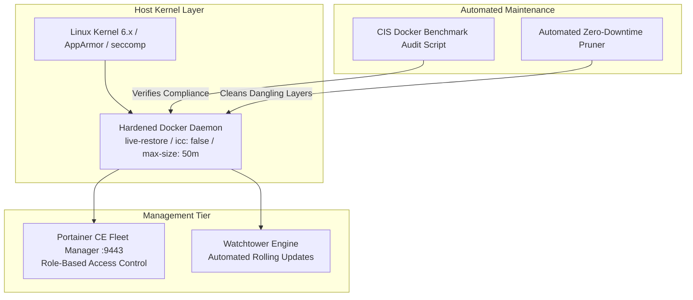

# :whale: Production Docker Fleet Management & Security Hardening

[](https://docker.com)
[](scripts/cis-docker-audit.sh)
[](https://portainer.io)
[](compose/docker-compose.yml)

A production-hardened Docker fleet deployment framework engineered for private cloud nodes. Enforces Center for Internet Security (CIS) daemon security baselines, prevents container breakout vulnerabilities (`no-new-privileges`), restricts inter-container communication (`icc: false`), caps log storage exhaustion, and automates rolling container maintenance via Watchtower.

---

## :triangular_ruler: Fleet Management Architecture



---

## :shield: CIS Security Hardening Controls (`daemon.json`)

| Security Directive | Value | Production Rationale |
| :--- | :--- | :--- |
| `no-new-privileges` | `true` | Prevents privilege escalation attacks inside containers (`setuid`/`setgid`). |
| `icc` | `false` | Disables unrestricted Inter-Container Communication on default bridge. |
| `userland-proxy` | `false` | Routes container traffic directly through Linux kernel `iptables` for performance and security. |
| `live-restore` | `true` | Keeps containers alive without downtime when updating or restarting the Docker daemon. |
| `log-driver` | `json-file` | Implements rotating log caps (`50m`, max 3 files) preventing disk exhaustion. |

---

## :rocket: Deployment & Auditing

### 1. Apply Hardened Daemon Configuration
```bash
git clone https://github.com/Aryan-136/docker-infrastructure.git
cd docker-infrastructure

# Copy hardened daemon config
sudo cp configs/daemon.json /etc/docker/daemon.json
sudo systemctl restart docker
```

### 2. Run CIS Compliance Audit
```bash
chmod +x scripts/*.sh
./scripts/cis-docker-audit.sh
```

### 3. Launch Fleet Management Stack
```bash
docker compose -f compose/docker-compose.yml up -d
```

---

## :file_folder: Repository Layout
```text
.
├── compose/
│   └── docker-compose.yml        # Portainer CE & Watchtower fleet manager
├── configs/
│   └── daemon.json               # CIS-hardened Docker daemon configuration
├── scripts/
│   ├── cis-docker-audit.sh       # Automated CIS benchmark compliance scanner
│   └── cleanup-fleet.sh          # Safe zero-downtime layer pruner
└── README.md                     # Security controls & operational manual
```