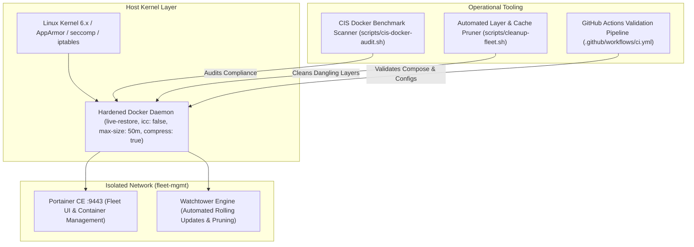

# :whale: Production Docker Fleet Management & Security Hardening

[](https://docker.com)
[](scripts/cis-docker-audit.sh)
[](https://portainer.io)
[](compose/docker-compose.yml)
[](.github/workflows/ci.yml)

A production-hardened Docker fleet deployment framework engineered for cloud nodes and enterprise hosts. Enforces Center for Internet Security (CIS) daemon security baselines, prevents container breakout vulnerabilities (`no-new-privileges`), restricts inter-container communication (`icc: false`), caps and compresses log storage, isolates management services on dedicated bridge networks, and automates rolling container maintenance via Watchtower.

---

## :triangular_ruler: Fleet Management Architecture



---

## :shield: CIS Security Hardening Controls (`daemon.json`)

| Security Directive | Value | CIS Reference | Production Rationale |
| :--- | :--- | :--- | :--- |
| `no-new-privileges` | `true` | CIS 2.1 | Prevents privilege escalation attacks inside containers (`setuid`/`setgid`). |
| `icc` | `false` | CIS 2.2 | Disables unrestricted Inter-Container Communication on default bridge. |
| `log-driver` | `json-file` | CIS 2.12 | Enforces centralized container logging. |
| `log-opts.max-size` | `50m` | CIS 2.12 | Caps individual log files to 50MB, preventing disk exhaustion. |
| `log-opts.max-file` | `3` | CIS 2.12 | Restricts log retention to a maximum of 3 rotated files. |
| `log-opts.compress` | `true` | SRE Best Practice | Compresses rotated log archives with gzip to save 80%+ disk space. |
| `live-restore` | `true` | CIS 2.14 | Keeps containers alive without downtime when updating or restarting the Docker daemon. |
| `userland-proxy` | `false` | CIS 2.15 | Routes container traffic directly through Linux kernel `iptables` for performance and security. |
| `default-ulimits.nofile` | `65535` | CIS 2.18 | Raises file descriptor ceiling to handle high-concurrency microservices. |

---

## :rocket: Deployment & Operations

### 1. Apply Hardened Daemon Configuration

```bash
git clone https://github.com/Aryan-136/docker-infrastructure.git
cd docker-infrastructure

# Copy hardened daemon config and reload service
sudo cp configs/daemon.json /etc/docker/daemon.json
sudo systemctl restart docker
```

### 2. Run CIS Compliance Audit

The audit script works against live running daemons or in static evaluation mode:

```bash
chmod +x scripts/*.sh

# Run audit against system daemon
./scripts/cis-docker-audit.sh

# Or evaluate against custom daemon.json path
DOCKER_DAEMON_JSON=configs/daemon.json ./scripts/cis-docker-audit.sh
```

### 3. Launch Fleet Management Stack

```bash
cd compose

# Optional: customize port or schedule in .env
cp .env.example .env

# Deploy Portainer CE and Watchtower
docker compose up -d
```

### 4. Automated Fleet Cleanup

Reclaims storage without destroying persistent volumes:

```bash
# Preview assets to be cleaned without deleting
./scripts/cleanup-fleet.sh --dry-run

# Run full automated cleanup
./scripts/cleanup-fleet.sh
```

---

## :file_folder: Repository Layout

```text
.
├── .github/
│   └── workflows/
│       └── ci.yml                # Automated CI pipeline (config & script linting)
├── compose/
│   ├── .env.example              # Environment variables template
│   └── docker-compose.yml        # Hardened Portainer CE & Watchtower fleet stack
├── configs/
│   └── daemon.json               # CIS-hardened Docker daemon configuration
├── scripts/
│   ├── cis-docker-audit.sh       # Automated CIS benchmark compliance scanner
│   └── cleanup-fleet.sh          # Safe zero-downtime layer & cache pruner
└── README.md                     # Security controls & operational manual
```
